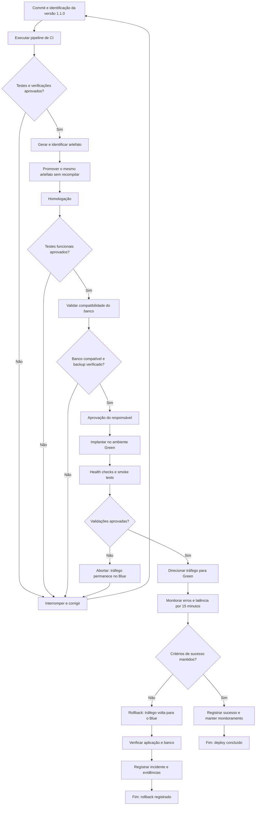
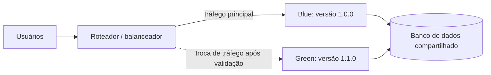

# 03 — Fluxo do Pipeline de Deploy

## 1. Objetivo

Representar o fluxo de Entrega Contínua (CD), desde a alteração do código até a implantação, a observação das métricas e o eventual rollback.

## 2. Diagrama do Pipeline

Se a validação do Green falhar **antes** da troca, o tráfego nunca saiu do Blue; por isso o caminho é "abortar", e não "rollback". O rollback só existe depois que o tráfego foi para o Green.

## 3. Arquitetura Blue/Green em Produção

Os dois ambientes usam o mesmo banco, por isso as alterações precisam ser compatíveis com as duas versões (ver [01-plano-de-deploy.md](01-plano-de-deploy.md), seção 5).

## 4. Gates do Pipeline

Gates são condições obrigatórias para que a implantação avance.

| Gate | Condição para avançar | Se falhar |
|------|----------------------|-----------|
| 1 — Qualidade | Testes obrigatórios e verificações de segurança aprovados | Interromper e corrigir |
| 2 — Homologação | Funcionalidades críticas, especialmente empréstimos e devoluções, funcionando | Interromper e corrigir |
| 3 — Banco de dados | Compatibilidade com as duas versões confirmada e backup verificado | Interromper e corrigir |
| 4 — Saúde da aplicação | Health checks e smoke tests aprovados no Green | Abortar; tráfego permanece no Blue |
| 5 — Observabilidade | Erros, latência e operações críticas dentro dos limites após a troca | Acionar o rollback |
| 6 — Rollback | Se os critérios críticos falharem, o tráfego volta à versão estável (desde que compatível com o banco) | Avaliar roll forward |

Antes da troca de tráfego há também a **aprovação manual** do responsável pelo deploy, registrada com evidências e critérios.

## 5. Métricas Observadas

Os limites completos estão na tabela da [seção 9 do plano de deploy](01-plano-de-deploy.md). Resumo:

- **Taxa de erros:** meta inicial inferior a 2%.
- **Latência p95:** meta inicial inferior a 1 segundo, ou dentro do limite operacional aprovado.
- **Health checks:** aplicação apta a receber tráfego (readiness).
- **Operações de empréstimo:** conclusão correta e sem inconsistências.
- **Tempo de recuperação:** meta de planejamento de até 5 minutos de indisponibilidade.

Os valores são metas propostas para a atividade e precisam ser validados com os dados reais do serviço.

## 6. Evidências da Implantação

A equipe deve guardar:

- identificação do commit e da versão;
- resultados dos testes;
- aprovação da implantação;
- resultado dos smoke tests;
- métricas antes e depois do deploy;
- horários de implantação e de eventual rollback;
- resultado da verificação do banco de dados.

O modelo de registro está na seção 13 do [plano de deploy](01-plano-de-deploy.md).

## 7. Conclusão

O pipeline proposto estabelece verificações antes e depois do deploy. A promoção depende de critérios objetivos e a recuperação possui um fluxo definido. A estratégia Blue/Green, combinada com testes, compatibilidade do banco e observabilidade, busca reduzir o risco de falhas e manter a disponibilidade do sistema.
