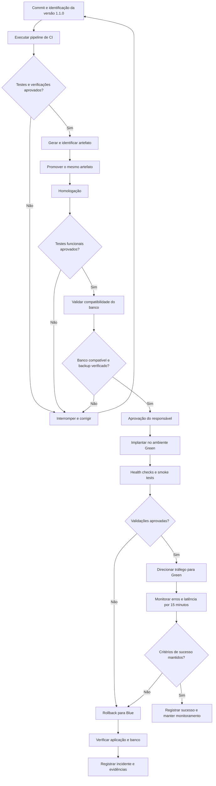

 03 — Fluxo do Pipeline de Deploy

 1. Objetivo

Representar o fluxo de Entrega Contínua (CD), desde a alteração do código até a implantação, observação das métricas e eventual rollback.

 2. Diagrama

3. Gates do Pipeline

Os gates são condições obrigatórias para que a implantação avance.

 Gate 1 — Qualidade
Os testes obrigatórios e as verificações de segurança devem ser aprovados.

 Gate 2 — Homologação
As funcionalidades críticas, especialmente empréstimos e devoluções, devem funcionar corretamente.

 Gate 3 — Banco de Dados
A compatibilidade entre as versões da aplicação e o banco compartilhado deve estar confirmada.

 Gate 4 — Saúde da Aplicação
Os health checks e os smoke tests devem ser aprovados antes da troca de tráfego.

 Gate 5 — Observabilidade
Após a troca, a equipe deve acompanhar a taxa de erros, a latência e as operações críticas.

 Gate 6 — Rollback
Se os critérios críticos falharem, o tráfego deverá retornar à versão estável, desde que ela seja compatível com o estado atual do banco.

 4. Métricas Observadas

- Taxa de erros: meta inicial inferior a 2%.
- Latência p95: meta inicial inferior a 1 segundo, ou dentro do limite operacional aprovado.
- Health checks: aplicação apta a receber tráfego.
- Operações de empréstimo: conclusão correta e sem inconsistências.
- Tempo de recuperação: meta de planejamento de até 5 minutos de indisponibilidade.

Os valores são metas propostas para a atividade e precisam ser validados com os dados reais do serviço.

 5. Evidências da Implantação

A equipe deverá guardar: 

- Identificação do commit e da versão.
- Resultados dos testes.
- Aprovação da implantação.
- Resultado dos smoke tests.
- Métricas antes e depois do deploy.
- Horários de implantação e de eventual rollback.
- Resultado da verificação do banco de dados.

 6. Conclusão

O pipeline proposto estabelece verificações antes e depois do deploy. A promoção depende de critérios objetivos e a recuperação possui um fluxo definido. A estratégia Blue/Green, combinada com testes, compatibilidade do banco e observabilidade, busca reduzir o risco de falhas e manter a disponibilidade do sistema.
